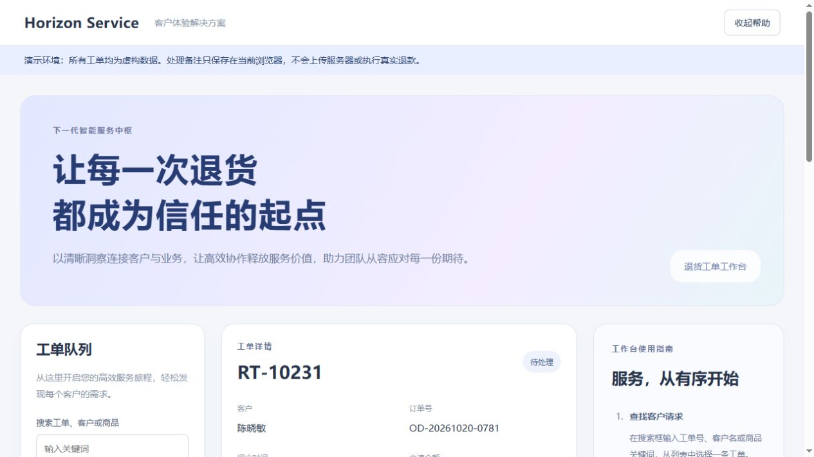
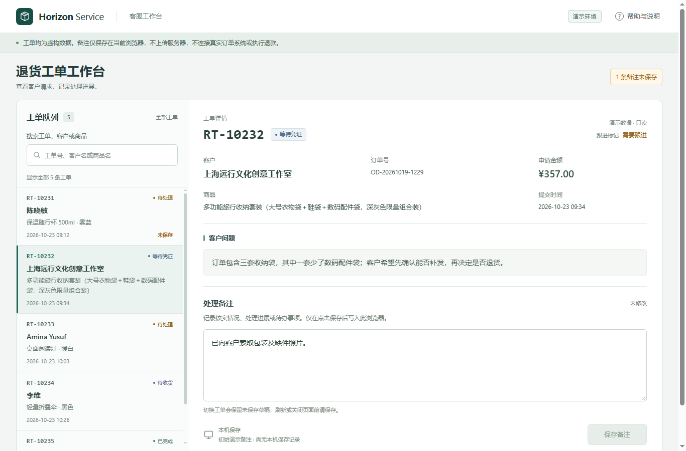

# 0.11.1 前端研究与一次新任务试跑

2026-10-23，独立分支 `feat/frontend-quality`，不合并 main，不发布 Release。当前用户级安装仍为 0.11.0；0.11.1只安装到隔离试跑项目与临时安装检查目录。入口候选冻结于 `31ebbd3b58a15785c2d942ad726b30304ac91fb2`。

本轮把“界面说明太多、像展示原型而不像日常系统”的反馈转成可验证问题，先研究方法，再归纳到按需引用，最后做一次新页面任务。产物改善是这个样例的观察；没有无 Skill 或其他 Skill 对照，不能归因于新增文字，也不能证明顶级审美。

## 学了什么，如何取舍

- [Anthropic frontend-design](https://github.com/anthropics/skills/blob/dbd4588f9e1033efb41dad4bef2f7947c8993d44/skills/frontend-design/SKILL.md)：从真实使用者、内容与任务组织界面，保留克制和自我批评；不把品牌展示页的风格偏好套给所有工作台。
- [Vercel Web Interface Guidelines](https://vercel.com/design/guidelines)：学习键盘、焦点、反馈和内容处理。品牌文案偏好不通用化；移动输入的缩放示例与“不要禁用缩放”的冲突不照抄。外来 Skill 的入口和实际规则源分别核实。
- [Carbon 数据表](https://www.carbondesignsystem.com/building-blocks/core/components/data-table/guidelines)、[NN/G 渐进呈现](https://www.nngroup.com/articles/progressive-disclosure/)：按比较、阅读和操作需要安排空间，罕用帮助按需提供；重要或高频信息仍直接可见。
- [Atlassian 消息设计](https://atlassian.design/foundations/content/designing-messages)、[WCAG 2.2](https://www.w3.org/TR/2024/REC-WCAG22-20241212/)：错误、状态、标签与恢复必须可理解，减少解释不能以隐藏风险或伪报成功为代价。

原始研究与证据边界见 [Skill研究](skill-research.md)、[产品研究](product-research.md)、[Skill来源快照](sources-skills.json)和[产品来源](sources-product.json)。未安装或执行外来 Skill，未复制其文段或代码。来源不是效果证明。

## 进入 Skill 的最小改动

入口只增加一段条件路由，内容在 [frontend-quality.md](../../skill/solo-dev-delivery/references/frontend-quality.md)：按页面职责决定文案、信息密度、视觉和相关交互检查。普通小文案／样式修复复用现有样板，不新增问卷、逐页审批、默认设计角色链、固定字数或像素预算。

[内容独立审查](content-review.md)首轮发现一处 P2：对卡片、分栏和动效使用“只在”的条件过窄。已区分高频工作台与营销／展示用途，复查关闭；没有以少写说明为由删除演示环境、权限、费用、未保存或失败提示。数据库与后端能力列入[迭代路线](../../ROADMAP.md)，本轮没有凭 UI 或架构名词宣称高并发。

## 新任务与原生执行

独立作者未读候选方法，生成五条虚构数据的退货工单页面、公开任务与契约。题面允许不同布局和帮助方式，不规定 DOM、风格、字数或卡片数量。生成器七项自测通过，不能算界面验收。见 [公开任务](fixture/TASK.md)、[功能契约](fixture/APP_CONTRACT.md)、[生成器](fixture-author/build_fixture.py)。作者侧材料在执行结束后才进入本证据目录。

执行器使用隔离的原生 Codex 项目／用户目录，显式禁用真实用户 Skill，安装冻结的 26 文件独立包。使用 `gpt-6.1-sol / ultra / priority`，显式调用 `$solo-dev-delivery`；原生目录和命令观察确认加载了预期版本并读取前端引用。没有据此宣称宿主隐式选用、全局升级或其他平台加载已验证。原生观察、配置／来源边界及用量见 [native-observation.json](native-observation.json)。该隔离是实验约定，不是操作系统沙箱证明。

执行者移除了大宣传区与常驻实现说明，将页面整理为队列与详情，把帮助放入可发现入口；保留五条完整工单、字段含义、演示／本机保存边界、草稿、真实成功和故障提示。它自行发现保存操作偏低并调整详情区与队列滚动。主 Agent 未向其追加具体修复提示，也未修改其交付代码。

**本次不是一次运行完成。** 首轮触及试验设置的 900 秒检查点被中断；随后收集器误把 Chrome 缓存纳入源文件哈希，遇到锁文件报错。第一次记录保留，未重新开题洗掉失败。收集器改为只核明确交付文件，同一会话收到一次通用接续消息后完成，续接 359.25 秒。原生会话最终正常结束；临时认证副本已删除。真实用户介入 0 次，实验接续消息 1 次。研究者／主 Agent 的诊断和复核不能算免费。

## 验证结果与实际范围

- 本机 Skill 格式检查、14 项导出／安装集成测试通过；两次规范 Git 源导出字节一致，临时安装核对26文件。0.11.1 ZIP 的 SHA-256 为 `9ee6b3a2e32e9fcbca5945cb60d3d181bb095f2c6fca2aee4731da85d94a1be3`。
- [候选 CI](https://github.com/lizi-product-studio/solo-dev-delivery/actions/runs/39927896363)成功，覆盖三系统／两 Python 版本、原生兼容及规范源打包比对。最后的证据文档提交不作为新运行时能力。
- 执行者先运行 Chrome 50 项功能／布局检查，最后小改后再运行12项定向检查。不是62项独立任务，也没有宣称最终代码完整重跑全部50项。明细与最终检查时间见 [浏览器自查](submission/verification/results.json)。
- 主 Agent 另用内置浏览器实际操作搜索／清空、草稿切换、保存与刷新、故障保存与正常页读回、帮助 Escape 和返回焦点，并查看长内容、桌面和窄窗口。最终版本再次实测保存／读回与故障不覆盖旧值。内置浏览器原生确认框控制曾超时，已从独立正常页恢复核验；该接口失败不记为原生退出通过，执行者的 Chrome 确认框检查单独保留。
- [独立代码与截图复核](fixture-author/output-review.md)未发现 P1／P2；记录了检查时的 SHA 与早期图片／测试范围，没有把自查全绿等同审美优秀。最终代码 SHA 见 [results.json](results.json)，证据文件摘要见 [ARTIFACTS.json](ARTIFACTS.json)。

原型前后可复核：

| 原型首屏，实际截图1265×712 | 改造后，实际 Chrome 截图1366×900 |
| --- | --- |
|  |  |

[最终失败提示](screenshots/failure-final.jpg)与[窄窗口](screenshots/after-narrow.jpg)为主 Agent 内置浏览器截图，JPEG原字节保留。截图尺寸是实际返回值，不把视口请求、截图存在或 DOM 边界当作视觉验收本身。

未验收实际移动设备、其他浏览器、屏幕阅读器或完整 WCAG 合规；未做数据库、服务端、性能容量或真实业务操作。这里只能说明一个明确的 UI 整理任务完成并留下了证据。

## 成本与后续判断

原生同一线程两回合累计记录去重后：总输入 2,597,683，其中缓存 2,538,880、未缓存 58,803；输出52,606，其中推理15,373。缓存已包含在总输入，推理已包含在输出，不重复相加。不换算订阅额度或金额。首轮在900秒被截断，续接359.25秒；不能把它写成只花续接时间。研究、出题、主 Agent 浏览器验证和独立审查的完整总用量未齐，保留未知，不填0。

下一步用真实项目检验方法是否减少返工、无用文案和交接，以及总消耗是否值得；证据不足或反效果时缩小、修订或撤回指导。前一轮[18次对照](../skill-comparison-2026-10-23/REPORT.md)三组质量均6/6，没有证明 Solo 相比无额外 Skill 的成功率收益；本次单例不改写该结论。

## 复核方式

本样例仅依赖本机静态页面。查看 `submission/index.html`，或在 `submission/` 运行 `python -m http.server 8765 --bind 127.0.0.1`；`?failSave=1`仅模拟本机保存失败。实际测试只使用虚构备注。重新生成原型可用 Python3.12执行 `fixture-author/build_fixture.py --out /absolute/new-directory`，不覆盖非空目录。

执行者提供的 [DELIVERY.md](submission/DELIVERY.md)和两个检查脚本记录本机 Chrome／Node24 的复核方式；不是所有平台的通用浏览器驱动。原生会话日志、用户配置、认证、Chrome profile 和真实客户页面未进入此目录。
